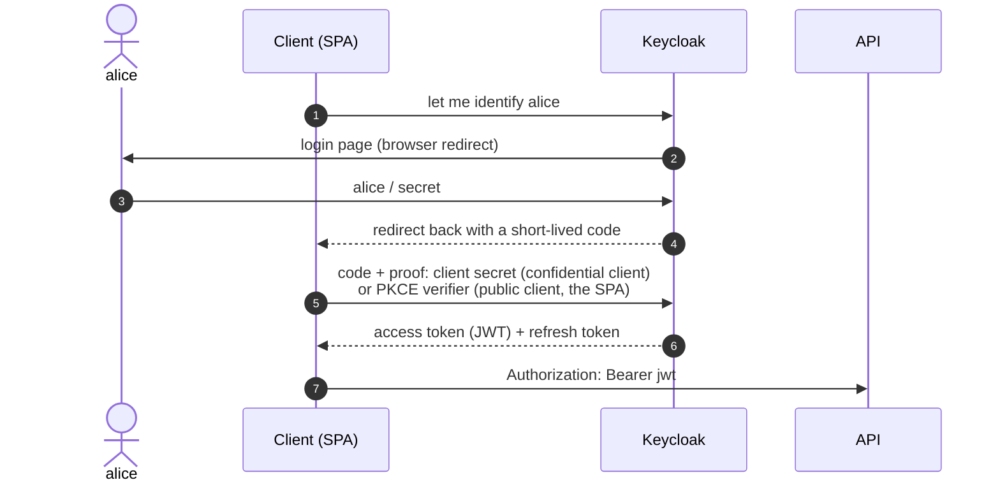

# TP Keycloak primer — Keycloak, OAuth2, OIDC, JWT

Background for [`../exercise.md`](../exercise.md): what Keycloak is, the three
protocols it speaks, and how to test if you choose to. Read it once before
Step 1.

## What is Keycloak?

**Keycloak is an open-source Identity and Access Management (IAM) server.**
It is the *single place* that knows who the users are, how to log them in,
and how to prove their identity to other applications.

| Question | Answer |
|---|---|
| Where do I put the users? | **Realm** (think of a tenant / a company). This TP has one realm: `listings`. |
| Where do I put an application that uses Keycloak? | **Client** (a "client" = one API or SPA that speaks to Keycloak). We have `listings-api` and `listings-spa`. |
| Where do I put the users' credentials? | In a **User** object inside the realm — never in your app. |
| How does my app say *who is calling*? | A **token** (a JWT) signed by Keycloak, carried in the `Authorization: Bearer <jwt>` header. |
| How does my app decide *what is allowed*? | From the **claims** of the JWT (here: `sub` and `realm_access.roles`). |

Three Keycloak objects you will meet in this TP:

| Keycloak object | Example in this realm |
|---|---|
| **Realm** (tenant) | `listings` |
| **Client** (application) | `listings-api` (confidential), `listings-spa` (public) |
| **User** | `alice`, `bob` — realm role `seller`; `carol` — no role (to test the 403) |

Keycloak is a **server**, not a Spring Boot starter, not a Java library. It
talks to your app over HTTP using standard protocols:
**OAuth2** (the grant flows), **OIDC** (the identity layer on top), and
**JWT** (the token format). The next section walks through those three.

> **Mental model for the day:** *Keycloak is the "who + who allowed" server.*
> Your Spring Boot app is the *what* server. They talk through JWTs.

## OAuth2, OIDC, JWT

New to the three? This is the 2-minute mental model (details per step below).

### OAuth2 (the "delegation" protocol)

Four players:

| Role | In this exercise |
|---|---|
| **Resource Owner** | the end user (`alice`, `bob`) — owns the data |
| **Client** | a browser/SPA, or a script (Postman) that acts on the user's behalf |
| **Authorization Server** | Keycloak — knows the users, issues tokens |
| **Resource Server** | the listings API (TP1) — serves the listings, verifies tokens |

> Note: the resource owner does **not** talk to the resource server directly
> about identity — they log in at the authorization server (Keycloak).

Core flow: the **authorization code flow**, the modern secure one (the SPA
uses it in Step 7; scripts use the simpler password grant of Step 2):

A browser application cannot keep a secret (its code runs on the user's
machine): it is a **public** client and proves itself with **PKCE** instead.

### OIDC (OpenID Connect)

OIDC = OAuth2 + a **standard identity layer**. It standardises the claims
in the token (`sub`, `email`, `preferred_username`, `realm_access`…) and
gives you a well-known metadata endpoint:

`http://localhost:8081/realms/listings/.well-known/openid-configuration`

### JWT (the token format)

A JWT is three base64url parts: `header.payload.signature`.

- **header**: `{ alg: "RS256", typ: "JWT" }`
- **payload**: the interesting part — a set of **claims**
- **signature**: the payload signed with Keycloak's **private key**

The API verifies the signature with the **public key** obtained from the
**JWKS** endpoint (`.../protocol/openid-connect/certs`). It never stores
the secret; it just checks the signature, issuer, audience, expiry.

> **Tip:** to read a JWT without a library, paste it in a JWT decoder
> website, or decode the middle segment with `base64 -d`. The `payload`
> is where the user's identity and roles live.

## Testing strategy (optional)

If you do write Java tests, `spring-boot-starter-test` and `spring-security-test`
are already on the classpath (JUnit 5, AssertJ, Mockito). The three levels to
consider: **Unit** (one service, `Jwt` mocked with Mockito), **Slice** (web layer
only, `@WebMvcTest`), **Integration** (real stack against the running Keycloak,
`@SpringBootTest` + `WebTestClient`).

### What NOT to do (in production code)

- Don't store the password in your app — Keycloak owns it.
- Don't call Keycloak from inside the request path to "check the user".
  Let Spring Security verify the JWT (issuer / audience / signature, already done
  by `oauth2ResourceServer`).
